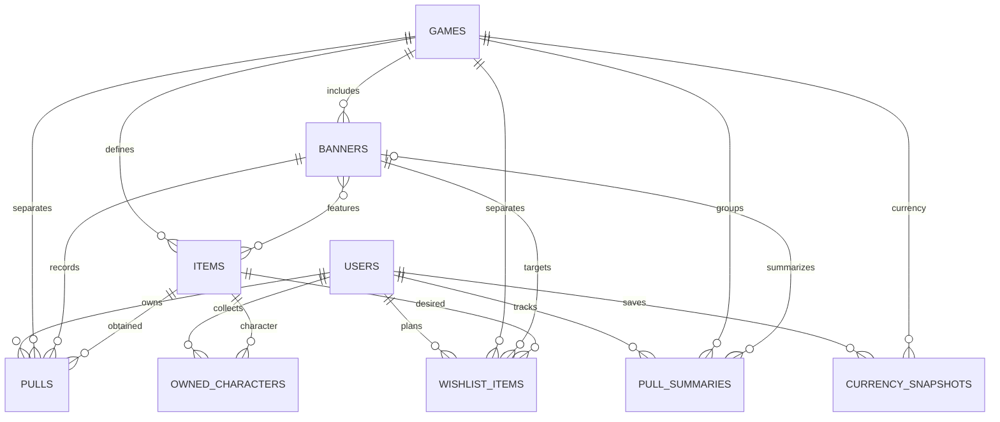

# 03 – Podatkovni model

Podatki se shranjujejo v **MongoDB**. Model loči katalog, osebne pridobitve in izračunane povzetke. Posamezne pridobitve vsebujejo samo redkosti 4★ in 5★; zapisi 3★ se med uvozom obdelajo za izračune in se ne shranijo kot dokumenti.

## Entitete (kolekcije)

### `users`

- `_id`, `username` (unikaten), `passwordHash`, `displayName`, `createdAt`.
- `role`: `"user"` | `"moderator"` | `"admin"`.

### `games`

- `_id`, `code` (`"hsr"` ali `"ww"`), `name`, `currencyName`, `pullCost`.
- `bannerRules`: seznam `{ key, type, hardPity4, hardPity5, featuredChance, guaranteeAfterLoss }`.
- Pravila in meje so določeni za vsako vrsto bannerja; neobstoječa meja se ne predpostavi.

### `banners`

- `_id`, `gameId` → `games`, `name`, `type` (`"character"`, `"weapon"`, `"standard"`).
- `startDate`, `endDate`, `imageUrl`, `featuredItemIds` → `items`.
- `ruleKey`: pravila izbrane igre; `pityGroupKey`: skupina bannerjev s skupnim pityjem.
- Časi so v UTC. Izpostavljeni predmeti pripadajo isti igri in ustrezajo vrsti bannerja.

### `items`

- `_id`, `gameId` → `games`, `name`, `kind` (`"character"` ali `"weapon"`).
- `rarity`: 4 ali 5; `portraitUrl`.
- Predmeta, povezanega z bannerjem ali pridobitvijo, ni mogoče izbrisati.

### `pulls`

- `_id`, `userId` → `users`, `gameId` → `games`, `bannerId` → `banners`, `itemId` → `items`.
- `externalId` (pri uvozu), `pulledAt`, `sequence`: izvorni vrstni red pri enakih časih.
- `pityAtPull`: obvezno pozitivno celo število, izračunano ob uvozu ali vneseno ročno; nanaša se na redkost pridobljenega predmeta.
- `isFeatured`, `wasGuaranteed`, `lostFiftyFifty`: izračunani podatki za statistiko; kadar pravilo ne velja, je vrednost `null`.
- `source`: `"url"` ali `"manual"`; podatek je interni in ni stolpec uporabniškega seznama.
- Delni unikaten indeks `(userId, gameId, externalId)` za zapise z zunanjim ID-jem.

### `pullSummaries`

- `_id`, `userId` → `users`, `gameId` → `games`, `pityGroupKey`, `bannerId` → `banners` (neobvezno).
- `scopeKey`: skupina ali posamezni dogodek; `totalPulls`, `isEstimated`, `fromDate`, `throughDate`, `updatedAt`.
- Za povzetek skupine še `currentPity4`, `currentPity5`, `isGuaranteed` in `currentPitySource` (`"import"` ali `"manual"`).
- Povzetek uvoza ohrani število vseh obdelanih pullov, tudi tistih brez shranjene pridobitve; pri ročnih podatkih je skupno število ocenjeno iz pityjev.
- Skupinski in dogodkovni povzetki so različna pogleda na iste pulle in se ne seštevajo med sabo. Ponovni uvoz upošteva že obdelano časovno območje in ne prišteje iste zgodovine ponovno.
- Unikaten indeks `(userId, gameId, scopeKey)`.

### `ownedCharacters`

- `_id`, `userId` → `users`, `itemId` → `items` (samo karakterji).
- `copies`: neobvezno ročno vneseno skupno število kopij karakterja, celo število od 0 naprej.
- Če `copies` ni nastavljen, se število kopij izračuna iz zgodovine pullov. Ročno vnesena vrednost nadomesti ta izračun in se mu ne prišteva.
- Primer: če zgodovina vsebuje 2 kopiji, uporabnik pa vnese 5, se prikaže 5 kopij in 4 dvojniki.
- Število dvojnikov je `max(skupno število kopij − 1, 0)`. Odstranitev ročne vrednosti znova uporabi zgodovino pullov. Ročni vnos ne spreminja pullov ali statistike.
- `level`, `upgradeLevel` (eidolon oziroma sequence), `stats` (objekt), `gear` (seznam).
- Unikaten indeks `(userId, itemId)`. Vsi karakterji za prikaz pridejo iz `items`; brez lastništva so prikazani sivo, zato ni treba ustvariti lastnega zapisa za vsak manjkajoči karakter.

### `currencySnapshots`

- `_id`, `userId` → `users`, `gameId` → `games`.
- `amount`, `tickets`, `recordedAt`.

### `wishlistItems`

- `_id`, `userId` → `users`, `gameId` → `games`, `bannerId` → `banners`, `itemId` → `items`.
- `addedAt`; brez polja prioritete. Razvrščanje po začetku bannerja in nato času dodajanja.
- Unikaten indeks `(userId, bannerId, itemId)`.

## Povezave

- Igra ima več bannerjev in predmetov (1 : N).
- Banner vsebuje več izpostavljenih predmetov, predmet pa se lahko pojavi na več bannerjih (N : M prek `featuredItemIds`).
- Pridobitev pripada uporabniku, igri, bannerju in predmetu (vsaka povezava N : 1).
- Uporabnik ima več povzetkov, lastnih karakterjev, zapisov valute in wishlist vnosov (1 : N).

## Osnutek modela

