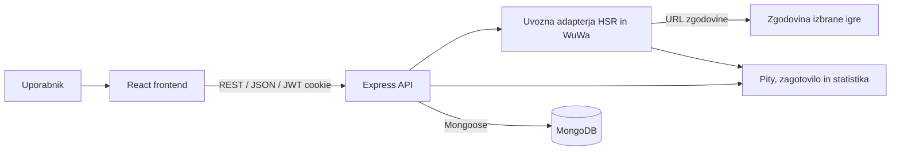

# 04 – Arhitektura in tehnološki sklad

## Glavni deli sistema

- **React frontend:** prikazuje zgodovino, uvoz, karakterje in koledar. Meni je levo, izbirnik igre v glavi, račun zgoraj desno. Uporabniške oznake so angleške.
- **Node.js in Express backend:** REST API za uporabnike, pridobitve, katalog in bannerje; vsebuje uvozna adapterja ter izračune pityja, zagotovila, statistik in kopij karakterjev.
- **MongoDB:** hrani uporabnike, katalog, 4★ in 5★ pridobitve, povzetke uvoza, lastništvo karakterjev in poznejše podatke za prihranke.

## Komunikacija in diagram

Frontend pošilja JSON zahtevke na REST API. Backend preveri prijavo in pravice ter z Mongoose bere in zapisuje MongoDB. Pri avtomatskem uvozu uporabi adapter izbrane igre za pridobitev zgodovine prek uporabnikovega URL-ja.

## Obdelava pridobitev

Avtomatski adapter obdeluje celotno dosegljivo zaporedje za izračun pityjev, trenutnih števcev in števila pullov. Posamezne zapise 3★ po obdelavi zavrže, shrani pa 4★ in 5★ pridobitve ter izračunane povzetke. Vsaka shranjena pridobitev ima določen pity. Če manjka začetek cikla, uporabnik pred potrditvijo dopolni začetno stanje. Ponoven uvoz ne sme podvojiti pridobitev, povzetkov ali kopij karakterjev.

Ročni zavihek zahteva pity ob pridobitvi in omogoča dopolnitev trenutnih pityjev. Zagotovilo se izračuna samodejno iz zaporedja rezultatov in pravil bannerja. Skupno število pullov se pri ročnem vodenju oceni iz zaporednih 5★ pityjev in trenutnega 5★ pityja; pityjev 4★ se ne prišteje ponovno. Če ni 5★ pridobitev, se uporabi 4★ zaporedje. Ocena in izpeljani deleži so tako označeni.

Statistika vključuje povprečni 5★ pity, delež 5★ pridobitev in uspešnost nezagotovljenih 50/50. Osebni indeks sreče je `100 × (H − povprečje) / (H − 1)`, kjer je H meja 5★ pityja. Pri bannerju brez pravila 50/50 se ta kazalnik ne pokaže. Ne gre za primerjavo z drugimi uporabniki.

## Avtentikacija in pravice

Prijava uporablja uporabniško ime in geslo; v bazi se shrani zgoščena vrednost gesla. JWT je v piškotku HttpOnly. Registracija ustvari vlogo `user`; vlogi `moderator` in `admin` dodeljuje administrator. Backend preverja pravice pri vsakem zahtevku in dostop do osebnih podatkov omeji na njihovega lastnika.

Moderator ureja bannerje, administrator katalog in uporabniške vloge. Administrator ima tudi moderatorske pravice. Urejanje kataloga ni dovoljeno moderatorju. Uvoz ne zahteva gesla igralnega računa.

## Tehnološki sklad

| Del | Tehnologija oziroma orodje |
| --- | --- |
| Frontend | React, Vite, CSS |
| Backend | Node.js, Express |
| Podatkovna baza | MongoDB Atlas, Mongoose |
| Avtentikacija | JWT v HttpOnly piškotku, bcrypt za gesla |
| Lokalni razvoj | npm, `.env` nastavitve; povezava z MongoDB Atlas |
| Diagrami in dokumentacija | Markdown, Mermaid |

## Lokalni zagon

1. V MongoDB Atlas pripravimo bazo, podatkovnega uporabnika in dovolimo dostop z naslova IP razvojnega okolja.
2. Backend nastavimo prek `.env`: povezovalni niz MongoDB Atlas (`MONGODB_URI`), JWT skrivnost, vrata in dovoljeni naslov frontenda.
3. Namestimo odvisnosti backenda in ga zaženemo z npm.
4. Namestimo odvisnosti frontenda ter zaženemo razvojni strežnik Vite; frontend uporablja lokalni naslov API-ja.
5. Začetni podatki vsebujejo obe igri, njuna pravila, katalog, bannerje in razvojne račune za tri vloge.

## Utemeljitev odločitev

- **React:** skupne komponente za meni, filtre, portrete, statistiko in obrazce zmanjšajo podvajanje vmesnika obeh iger.
- **Node.js in Express:** isti jezik na frontendu in backendu ter ločena adapterja omogočajo razširitev na dodatne igre.
- **MongoDB in Mongoose:** dokumenti omogočajo različne statistike karakterjev in pravila iger, sheme pa preverjajo obvezne podatke in povezave.
- **Samo 4★ in 5★ pridobitve ter povzetki:** aplikacija ohrani pomembne rezultate in izračunane števce brez shranjevanja posameznih 3★ zapisov. Povzetki so potrebni, ker samo iz redkih pridobitev ni mogoče obnoviti točnega števila vseh pullov.
- **Pravila po igri in skupini bannerjev:** preprečujejo mešanje pityja ter zagotovil med nezdružljivimi vrstami bannerjev.
- **MongoDB Atlas:** baza gostuje v oblaku, zato lokalna namestitev MongoDB ali Dockerja ni potrebna.
