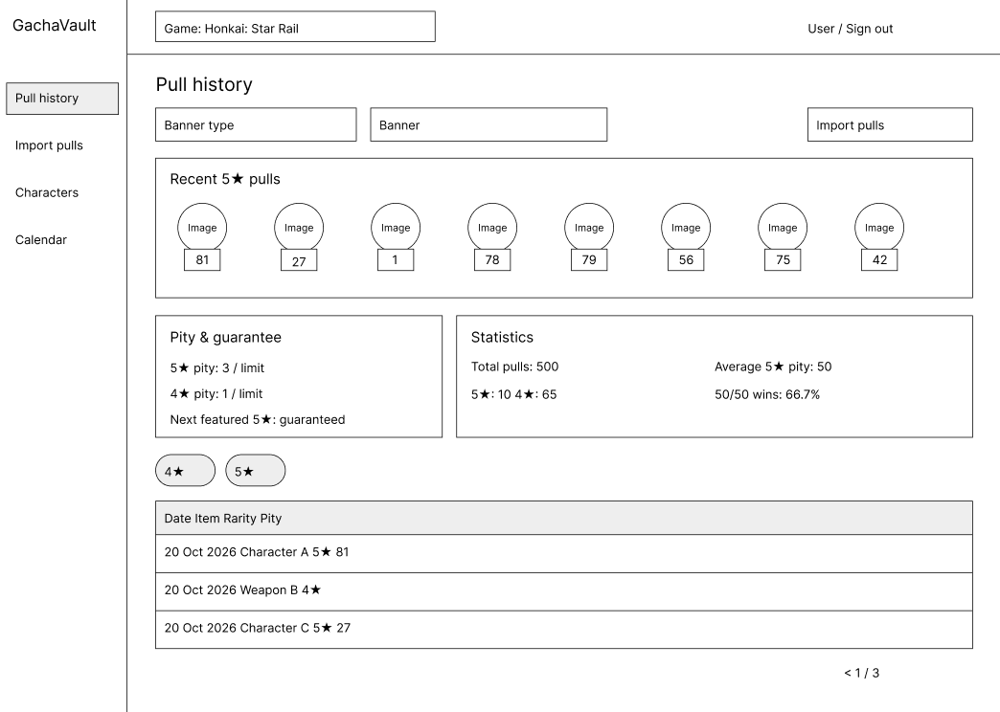
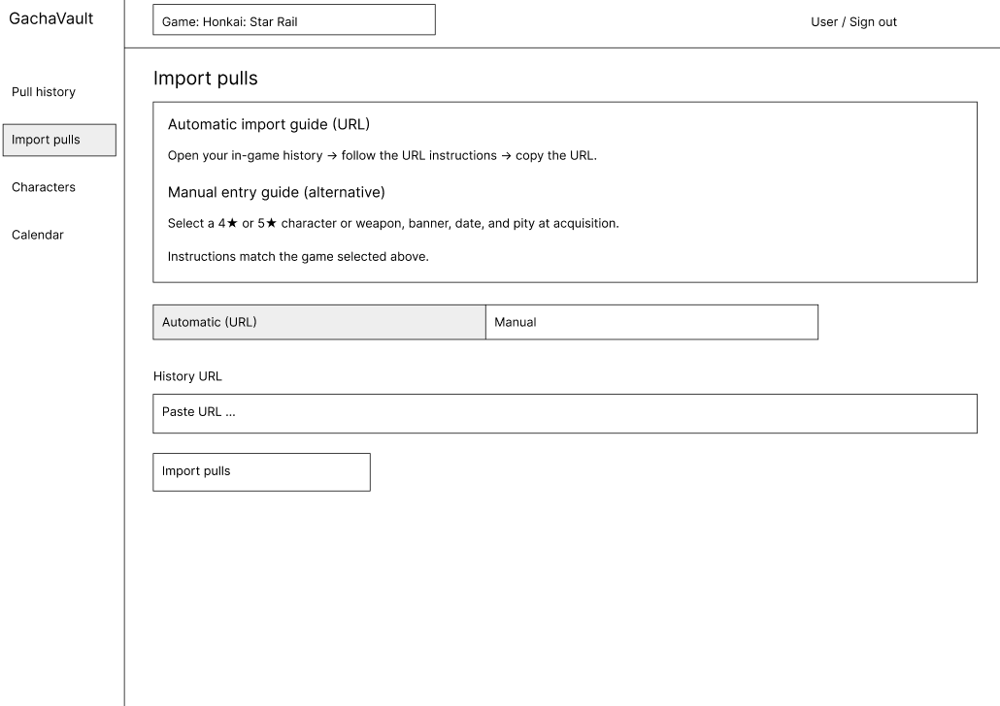
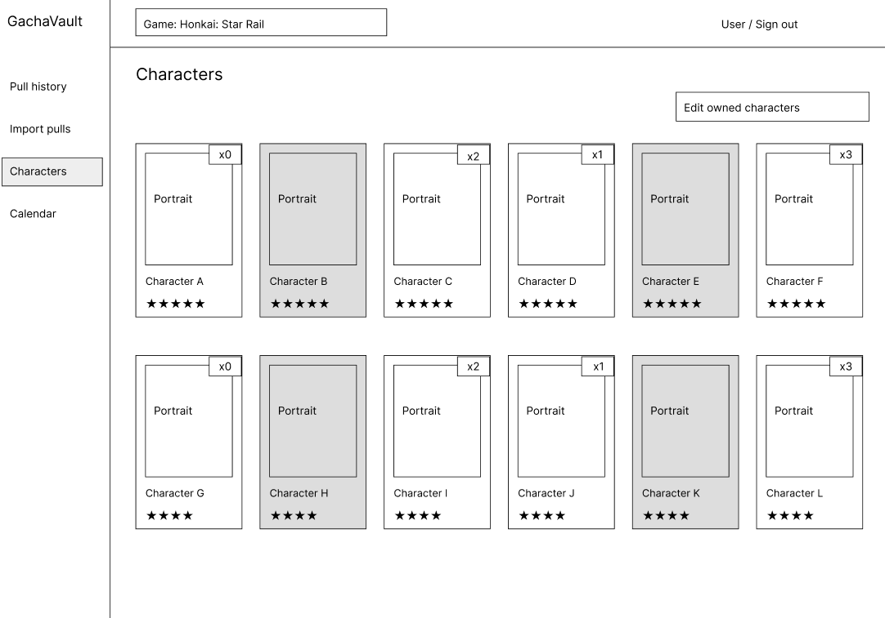
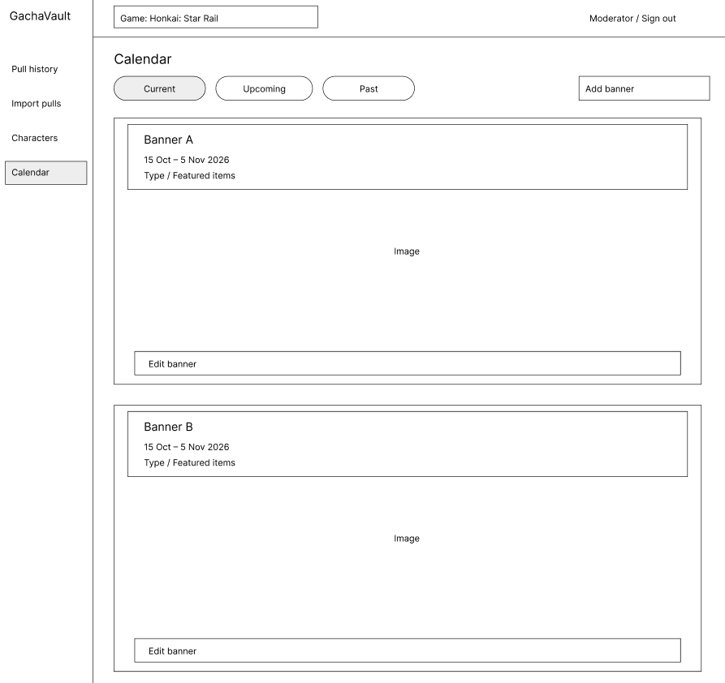

# 06 – Wireframe-i: GachaVault

## WF-01 – Pull history

Pregled zgodovine z izbiro vrste bannerja in dogodka, zadnjimi 5★ pridobitvami ter povzetkom pityja, zagotovila in statistike. Gumba 4★ in 5★ filtrirata prikaz pridobitev.

## WF-02 – Import pulls

Navodila predstavijo avtomatski in ročni način kot alternativa. Prikazan je avtomatski zavihek s poljem za URL in gumbom za uvoz; ročni način je dostopen prek drugega zavihka.

## WF-03 – Characters

Mreža vseh karakterjev izbrane igre z imenom, portretom in zvezdicami za redkost. Nepridobljeni karakterji so sivi, pridobljeni imajo v kotu število dvojnikov. Gumb »Edit owned characters« omogoča urejanje lastništva.

## WF-04 – Calendar

Filtri ločijo trenutne, prihajajoče in pretekle bannerje. Dva bannerja sta prikazana drug pod drugim s prostorom za sliko, imenom, terminom in izpostavljenimi predmeti. Moderatorski pogled vsebuje gumbe za dodajanje in urejanje.

